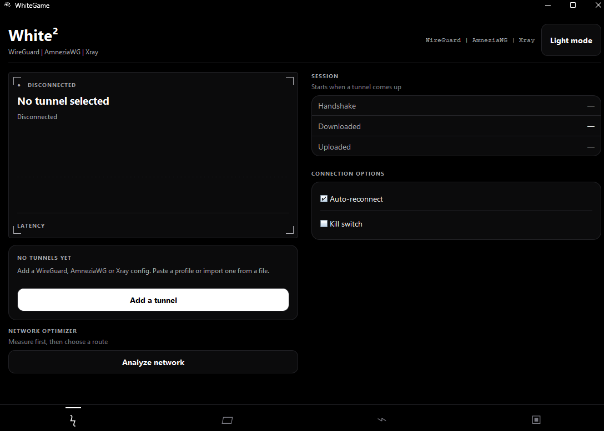
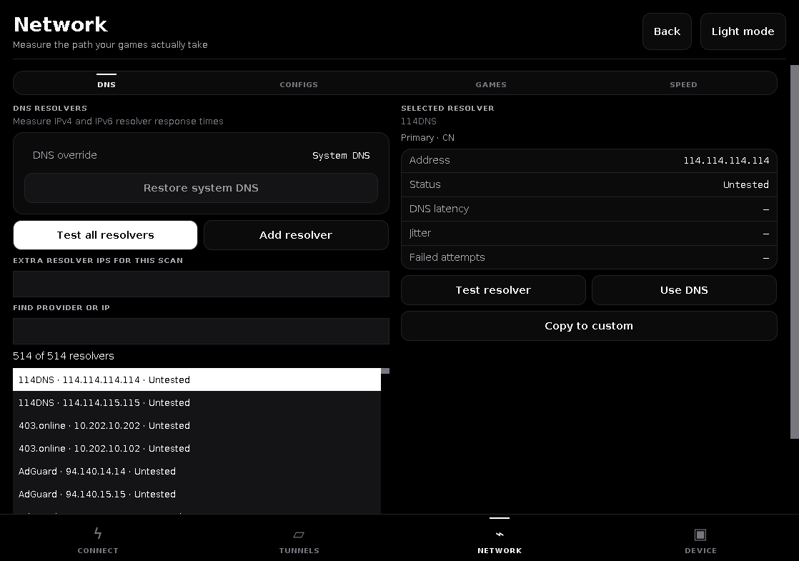

# WhiteGame

WhiteGame helps you check your connection for gaming on Android, Windows, and Linux. Test your speed, find installed games, and compare DNS resolvers and VPN profiles in one app.

**[Download the latest release](https://github.com/TaJirax/WhiteGame/releases/latest)**

## Get started

- **Android** · Download and open the universal APK.
- **Windows x64** · Extract the ZIP and open `WhiteGame.exe`.
- **Linux x64** · Extract the archive and run `WhiteGame/bin/WhiteGame`.

## What you can do

- Measure download, upload, and latency with Cloudflare Speed Test.
- Scan your device for installed games and compare latency to game services.
- Search, test, and apply DNS resolvers, including ones you add.
- Import and edit WireGuard, AmneziaWG, and Xray profiles. Measure latency and speed through supported tunnels.

## Desktop preview

See the Network screen

[Technical README](README-technical.md) · [Desktop setup](desktop/README.md) · [Report an issue](https://github.com/TaJirax/WhiteGame/issues/new)
